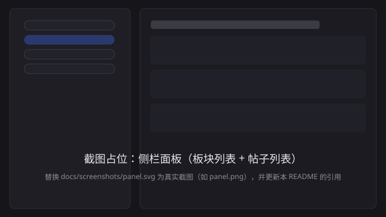
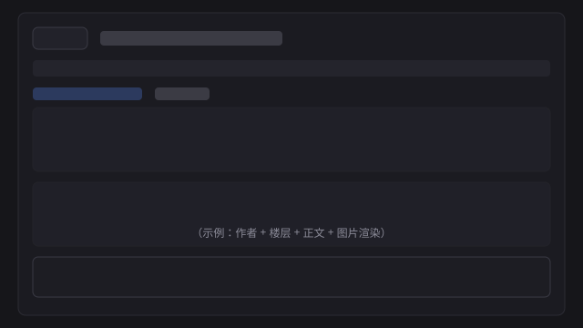
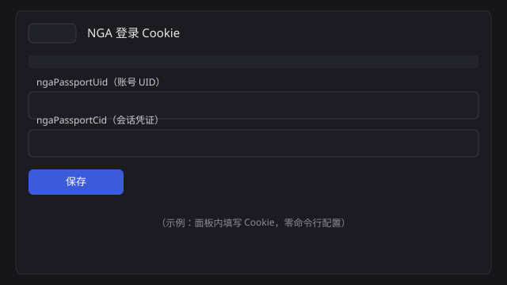

# dsh-nga-sidebar

> 在 DeepSeek Harness Web UI 的侧栏里逛 NGA：板块列表 → 帖子列表 → **面板内直接阅读**，无需跳转网页。

浏览器侧只与本机 dsh 的宿主代理通信，由宿主抓取 bbs.nga.cn 并解析，**零 CORS 问题、无 iframe 限制**。NGA 的反爬（JS 挑战、登录门槛）全部在宿主侧处理，你只需要在面板里填一次自己的登录 Cookie。

---

## 截图

> 📷 占位图为 SVG 示意，将 `docs/screenshots/` 下的对应文件替换为真实截图（PNG/JPG）并更新下方引用即可。

**侧栏面板**：竖排可滚动板块列表 + 帖子列表，板块自动显示真名



**面板内阅读**：作者/楼层/正文 + 图片渲染 + 引用回复排版 + 翻页与楼层跳转



**Cookie 设置**：面板内直接填写登录 Cookie，零命令行



---

## 功能特性

- 📚 **板块浏览**：竖排列表、可独立滚动；加载后自动显示板块**真名**（如"艾泽拉斯议事厅""碧蓝幻想"）
- 📄 **帖子列表**：标题 / 作者 / 回复数
- 📖 **面板内阅读**：正文 + **图片渲染** + 引用回复排版，无需离开 DSH
- 📑 **翻页与跳转**：长帖每页 20 楼，「上一页 / 下一页」+ 楼层跳转输入框
- ➕ **自定义板块**：按 fid 添加（带 × 可删），自动改真名；也可按 tid 直接打开任意帖子
- 🔔 **引导提示**：未配置 Cookie 时面板顶部显示黄色横幅，一键直达配置页

---

## 鸣谢

- **[DeepSeek Harness](https://github.com/deepseek-ai/deepseek-harness)** — 本插件运行其上的 Agent 框架。插件完全遵循 DSH 的插件模型（Cordis 组合、`dsh.bundle`/`dsh.client` 清单、客户端模块系统），无需改动 DSH 任何核心。
- **[dsh-douyin](https://github.com/AnacondaKC/dsh-douyin)** — 本插件的架构模板，沿用其大量设计：
  - **双模式挂载**：检测到 `dsh-better-sidebar` 时注册为侧栏 Tab，否则自绘浮动按钮 + 右侧 Dock；
  - **宿主代理路由模式**：浏览器只发参数、宿主拼 URL 抓取，SSRF 安全；
  - **数据驱动面板**：源列表 / 解析函数 / 面板组件分层；
  - **构建管线**：tsc + tsdown + 产物校验（`verify-artifacts.mjs`），lib/ 预构建提交，用户无需安装依赖。
  - 许可证沿用其 [BSD-3-Clause](LICENSE)。
- **[AgMonk/nga-api-doc](https://github.com/AgMonk/nga-api-doc)** — NGA 接口契约的社区文档，解析逻辑以其为准并实测校准。

---

## 安装

```sh
# 1) 构建插件（需要网络；pnpm 缺失时先 corepack enable 并重开终端）
cd <插件目录>
pnpm install
pnpm run build

# 2) 装进 web profile
cd <dsh 安装目录>
node apps\cli\lib\bin.js plugin --profile web add <插件目录>

# 3) 重启 dsh web
```

重启后右侧出现竖条 **"N"** 按钮（装了 [dsh-better-sidebar](https://github.com/omdsh-dev/DSH-better-sidebar) 则注册为侧栏 Tab）。
**注意：重启服务后要把浏览器 3080 标签页整个关掉重开**，客户端更新才会生效。

## 配置 NGA 登录 Cookie（必需）

### 为什么需要

NGA 反爬：匿名访问被 JS 挑战（`guestJs`）拦截，脚本模拟无法通过；JSON 接口（`__output=11`）必须登录。所以插件用**你的登录 Cookie** 走 JSON 接口取数据。

### 必要项（实测只需 2 个）

| Cookie 名 | 说明 |
|---|---|
| `ngaPassportUid` | 账号 UID |
| `ngaPassportCid` | 会话凭证（等同登录令牌） |

> ⚠️ 注意是**驼峰命名**（`ngaPassportUid`），不是 `nga_passport_uid`——名字写错会被 NGA 当作未登录。

### 配置步骤（二选一）

**方式 A：面板内填写（推荐，零命令行）**
打开面板 → 顶部「Cookie」按钮 → 填入 `ngaPassportUid` / `ngaPassportCid` → 保存。宿主持久化到本地文件（`~/.dsh/dsh-nga-cookies.txt`），重启不丢，板块立即刷新。

**方式 B：手改文件**
1. 浏览器登录 `https://bbs.nga.cn`；
2. `F12` → **Application/应用** → **Cookies** → `https://bbs.nga.cn`，复制 `ngaPassportUid` 和 `ngaPassportCid` 的值；
3. 用记事本打开（或新建）`~/.dsh/dsh-nga-cookies.txt`（如设置了 `DSH_NGA_COOKIES_FILE` 环境变量则写那个路径），写成一行：

```
ngaPassportUid=你的uid值; ngaPassportCid=你的cid值
```

4. 重启 dsh web（无需改动任何启动脚本）。

### 有效期 & 更新

- `ngaPassportUid/Cid` 有效期**约 1 年**（或到你改密码/登出为止）；
- 实际判断：板块开始报「此板块需要登录」时，重新导一次覆盖即可；
- 也可在 Cookie 文件里追加浏览器中的其他 NGA Cookie（`ngacn0comUserInfo*`、`lastvisit` 等），部分冷门板块更稳——但两个必要项已满足绝大多数场景。

---

## 使用说明

- **板块**：点击行切换；行右侧 `fid=` 是板块 id（浏览器打开板块页，URL 里 `fid=数字` 就是）
- **添加板块**：底部输入 fid →「添加」；自加板块右上角 × 可删；加载成功后自动改真名
- **按 tid 打开**：底部第二个输入框填帖子 tid → 回车直接进阅读视图
- **阅读**：点帖子标题 → 面板内显示正文；「← 返回」回列表；右上「网页版」在新标签页打开原帖
- **翻页 / 跳楼**：阅读页顶部「← 上一页 / 第 x/y 页 / 下一页 →」；输入楼层号回车直达
- **权限不足的板块**：会提示具体原因，删掉换别的即可（fid=7 等已实测可读）

---

## 故障排查

| 现象 | 原因 | 处理 |
|---|---|---|
| 面板顶部黄色横幅"未配置 NGA 登录 Cookie" | 宿主没读到 Cookie | 按上文方式 A 在面板里填写 + 保存 |
| 板块提示「此板块需要登录/权限不足」 | 该板块对当前账号门槛更高 | 换其他板块（fid=7 已验证可读） |
| 帖子打不开 / 显示加载失败 | 网络或该帖结构特殊 | 点「网页版」查看原帖；或 F12 看报错 |
| 点了没反应 / 面板还是旧的 | 浏览器页面缓存 | 整个关掉 3080 标签页重开 |
| 板块名显示"自定义 xxx" | 还没加载成功 | 加载成功后会自动改成真名 |

---

## 安全与隐私

- 浏览器只发 `fid` / `page` / `tid` 数字，**从不传 URL**；宿主用硬编码的 `https://bbs.nga.cn` 拼请求（SSRF 安全）
- 10s 超时、4MB 体积上限、并发 6 上限 + 60 次/10s 限流，失败静默降级
- **Cookie 是账号凭证**：只存本机（`~/.dsh/dsh-nga-cookies.txt`），不外传、不写日志；泄露后请改密码使旧会话失效
- 调试路由 `/dsh-nga/debug.json` 只暴露抓取状态与响应头（不含 Cookie 值），排障用

---

## 开发

```
src/nga-sources.ts    共享契约（类型 / 路由 / 默认板块）
src/index.ts          宿主代理：抓取 + 解析（SSRF 安全 + NGA 松散 JSON 处理）
src/client/index.ts   浏览器面板（板块 / 帖子 / 阅读三视图 + Cookie 设置）
cordis.patch.yml      挂载行
docs/NGA-PARSING-PITFALLS.md    NGA 数据解析踩坑总结（开发必读）
```

- 接口契约参考 [AgMonk/nga-api-doc](https://github.com/AgMonk/nga-api-doc)；NGA 改结构时调整 `src/index.ts` 的解析函数
- 解析策略：**JSON 优先、`noBBCode` HTML 兜底**（read.php JSON 可能被截断），细节见踩坑文档

## 发布

```sh
pnpm run build        # 确保 lib/ 为最新预构建产物
git init && git add . && git commit -m "release"
# 推送 GitHub 后，用户一行安装：
#   dsh plugin --profile web add github:<你的用户名>/dsh-nga-sidebar
```

> 发布前检查：仓库内**不应出现**任何个人路径（本地绝对路径）、账号 UID、Cookie 值；踩坑文档可保留供他人开发参考。

---

## License

[BSD-3-Clause](LICENSE)（沿用自 dsh-douyin）。仅供个人学习使用，注意 NGA 用户协议，请勿高频抓取。
